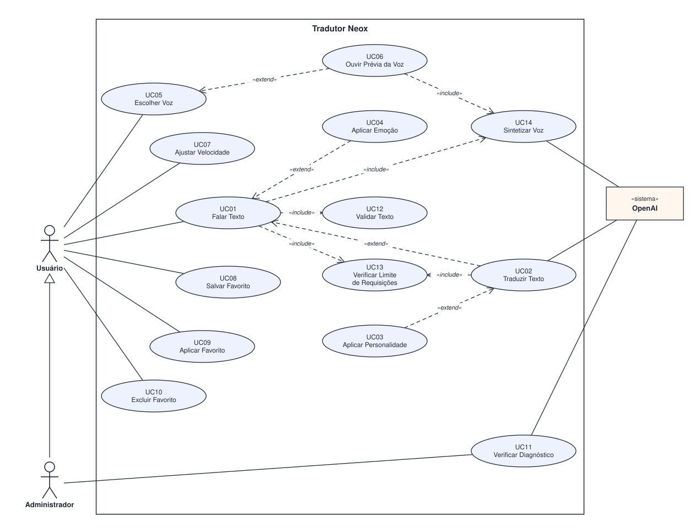

# 3. Casos de Uso

## 3.1 Atores

| Ator | Tipo | Papel |
| --- | --- | --- |
| Usuário | Principal | Digita o texto, escolhe idioma, voz, emoção, personalidade e velocidade, ouve a fala e gerencia favoritos |
| Administrador | Principal (generalização de Usuário) | Tudo que o Usuário faz e, além disso, verifica o diagnóstico do sistema (chave da API) |
| OpenAI `«sistema»` | Secundário (sistema externo) | Executa a tradução (`gpt-4o-mini`) e a síntese de voz (`tts-1`), e valida a chave da API |

> **Generalização:** o `Administrador` é um `Usuário` — herda todas as associações dele e acrescenta o caso de uso
> `Verificar Diagnóstico`. Por isso a seta de generalização aponta do `Administrador` para o `Usuário`.

## 3.2 Lista de casos de uso

| Código | Caso de uso | Tipo | Requisitos |
| --- | --- | --- | --- |
| UC01 | Falar Texto | Primário | RF-02, RF-11, RF-12, RN-10 |
| UC02 | Traduzir Texto | Primário (extensão de UC01) | RF-01, RN-03 |
| UC03 | Aplicar Personalidade | Extensão de UC02 | RF-06, RN-06 |
| UC04 | Aplicar Emoção | Extensão de UC01 | RF-05, RN-05 |
| UC05 | Escolher Voz | Primário | RF-03, RN-04 |
| UC06 | Ouvir Prévia da Voz | Extensão de UC05 | RF-04 |
| UC07 | Ajustar Velocidade | Primário | RF-07, RN-07 |
| UC08 | Salvar Favorito | Primário | RF-08, RN-08, RN-09 |
| UC09 | Aplicar Favorito | Primário | RF-09 |
| UC10 | Excluir Favorito | Secundário | RF-10 |
| UC11 | Verificar Diagnóstico | Secundário | RF-13 |
| UC12 | Validar Texto | Incluído por UC01 | RN-01, RN-10 |
| UC13 | Verificar Limite de Requisições | Incluído por UC01 e UC02 | RN-02 |
| UC14 | Sintetizar Voz | Incluído por UC01 e UC06 | RF-02, RN-04 |

### Relacionamentos

| Relacionamento | Tipo | Justificativa |
| --- | --- | --- |
| UC01 → UC12 | `«include»` | Todo texto é validado antes de ser falado |
| UC01 → UC13 / UC02 → UC13 | `«include»` | Toda requisição ao serviço externo passa pelo limite por IP |
| UC01 → UC14 / UC06 → UC14 | `«include»` | Falar o texto e ouvir a prévia sempre geram áudio pelo mesmo serviço de síntese |
| UC02 → UC01 | `«extend»` | **Condição:** um idioma de destino está selecionado. Com "Sem tradução", o texto original é falado |
| UC03 → UC02 | `«extend»` | **Condição:** o usuário informou uma personalidade |
| UC04 → UC01 | `«extend»` | **Condição:** a emoção escolhida é diferente de "Neutro" |
| UC06 → UC05 | `«extend»` | **Condição:** o usuário pede para ouvir a prévia antes de escolher |

## 3.3 Diagrama de casos de uso

Arquivo editável no Draw.io: [`diagramas/casos-de-uso.drawio`](diagramas/casos-de-uso.drawio)

**Como ler:** o `Usuário` se associa aos objetivos que ele inicia (falar, escolher voz, ajustar velocidade e
gerenciar favoritos). `Traduzir Texto`, `Aplicar Emoção` e `Aplicar Personalidade` só acontecem em certas
condições, por isso são `«extend»`. `Validar Texto`, `Verificar Limite de Requisições` e `Sintetizar Voz`
acontecem sempre que o caso de uso base é executado, por isso são `«include»`. A `OpenAI` fica fora da
fronteira do sistema: é um agente externo que participa da tradução, da síntese e do diagnóstico.

---

## 3.4 Documentação dos casos de uso

### UC01 — Falar Texto

| Campo | Conteúdo |
| --- | --- |
| **Nome** | Falar Texto |
| **Ator(es)** | Usuário (principal), OpenAI (secundário, via UC14) |
| **Descrição** | O usuário digita um texto e o sistema o reproduz em voz alta com a voz, a emoção e a velocidade configuradas, traduzindo-o antes quando houver idioma selecionado. |
| **Pré-condições** | A lista de vozes foi carregada. |
| **Fluxo principal** | 1. Usuário digita o texto. 2. Sistema exibe o contador de caracteres (RF-11). 3. Usuário clica em "Falar" (ou "Traduzir & Falar"). 4. Sistema executa `Validar Texto` (UC12). 5. Sistema executa `Verificar Limite de Requisições` (UC13). 6. Sistema executa `Sintetizar Voz` (UC14) com o texto e a voz escolhida. 7. Sistema reproduz o áudio na velocidade configurada. |
| **Fluxos alternativos** | 3a. Se houver idioma de destino selecionado, o sistema executa `Traduzir Texto` (UC02) antes do passo 6 e fala o texto traduzido. 7a. Se a emoção for diferente de "Neutro", o sistema executa `Aplicar Emoção` (UC04) durante a reprodução. |
| **Exceções** | 4a. Texto vazio ou com mais de 1000 caracteres: o sistema exibe a mensagem de erro e não envia a requisição. 5a. Limite de requisições excedido: o sistema exibe "Limite de requisições atingido. Tente novamente em N segundos." 6a. Falha no serviço de voz: o sistema exibe "Falha ao gerar áudio" e libera o botão. |
| **Pós-condições** | O áudio foi reproduzido e fica disponível no player para ser ouvido novamente. |

### UC02 — Traduzir Texto

| Campo | Conteúdo |
| --- | --- |
| **Nome** | Traduzir Texto |
| **Ator(es)** | Usuário (indireto, por UC01), OpenAI (secundário) |
| **Descrição** | O sistema traduz o texto do usuário para o idioma de destino escolhido. |
| **Pré-condições** | Um idioma de destino está selecionado e o texto já foi validado (UC12). |
| **Fluxo principal** | 1. Sistema executa `Verificar Limite de Requisições` (UC13). 2. Sistema confirma que o idioma está entre os 25 suportados (RN-03). 3. Sistema envia o texto e o idioma ao serviço de tradução da OpenAI. 4. OpenAI devolve o texto traduzido. 5. Sistema exibe o texto traduzido na seção "Tradução". |
| **Fluxos alternativos** | 3a. Se houver personalidade informada, o sistema executa `Aplicar Personalidade` (UC03), incluindo a instrução de tom na tradução. |
| **Exceções** | 2a. Idioma não suportado: o sistema retorna "Idioma de destino não suportado". 4a. Falha no serviço de tradução: o sistema exibe "Falha na tradução" e não segue para a síntese. |
| **Pós-condições** | O texto traduzido está disponível para ser falado (UC01). |

### UC05 — Escolher Voz

| Campo | Conteúdo |
| --- | --- |
| **Nome** | Escolher Voz |
| **Ator(es)** | Usuário |
| **Descrição** | O usuário escolhe, entre as 6 vozes disponíveis, a voz usada na fala. |
| **Pré-condições** | A lista de vozes foi carregada. |
| **Fluxo principal** | 1. Usuário clica em "Escolher voz". 2. Sistema abre a janela com as vozes, cada uma com nome e descrição. 3. Usuário clica em "Usar esta voz". 4. Sistema fecha a janela e exibe a voz escolhida ao lado do rótulo "Voz". |
| **Fluxos alternativos** | 3a. Usuário clica em "Prévia": o sistema executa `Ouvir Prévia da Voz` (UC06) e volta ao passo 3. 3b. Usuário pressiona ESC ou clica em "Fechar": a janela fecha sem alterar a voz. |
| **Exceções** | 2a. Falha ao carregar as vozes: o sistema exibe "Não foi possível carregar as vozes." |
| **Pós-condições** | A voz escolhida será usada nas próximas falas. |

### UC06 — Ouvir Prévia da Voz

| Campo | Conteúdo |
| --- | --- |
| **Nome** | Ouvir Prévia da Voz |
| **Ator(es)** | Usuário, OpenAI (secundário, via UC14) |
| **Descrição** | O sistema reproduz uma frase curta com a voz selecionada para que o usuário a conheça antes de escolher. |
| **Pré-condições** | A janela de escolha de voz está aberta. |
| **Fluxo principal** | 1. Usuário clica em "Prévia" em uma voz. 2. Sistema executa `Sintetizar Voz` (UC14) com a frase "Esta é uma prévia da voz [nome]". 3. Sistema reproduz o áudio na velocidade configurada. |
| **Fluxos alternativos** | — |
| **Exceções** | 2a. Falha no serviço de voz ou limite excedido: o sistema exibe a mensagem de erro correspondente. |
| **Pós-condições** | Nenhuma alteração de configuração. |

### UC08 — Salvar Favorito

| Campo | Conteúdo |
| --- | --- |
| **Nome** | Salvar Favorito |
| **Ator(es)** | Usuário |
| **Descrição** | O usuário salva a configuração atual de fala com um nome, para reutilizá-la depois. |
| **Pré-condições** | Nenhuma. |
| **Fluxo principal** | 1. Usuário clica em "Salvar como favorito". 2. Sistema pede o nome do favorito. 3. Usuário informa o nome e confirma. 4. Sistema valida o nome (RN-09). 5. Sistema salva voz, emoção, personalidade, idioma e velocidade no topo da lista de favoritos, no navegador. 6. Sistema atualiza o contador "Favoritos (N)". |
| **Fluxos alternativos** | 3a. Usuário cancela: nada é salvo. 5a. Já existem 40 favoritos: o mais antigo é descartado (RN-08). |
| **Exceções** | 4a. Nome vazio: o sistema exibe "Informe um nome para o favorito." 4b. Nome repetido: o sistema exibe "Já existe um favorito com esse nome." |
| **Pós-condições** | O favorito aparece na lista e continua salvo ao recarregar a página. |

### UC09 — Aplicar Favorito

| Campo | Conteúdo |
| --- | --- |
| **Nome** | Aplicar Favorito |
| **Ator(es)** | Usuário |
| **Descrição** | O usuário escolhe um favorito e o sistema preenche a configuração de fala com os valores salvos. |
| **Pré-condições** | Existe pelo menos um favorito salvo. |
| **Fluxo principal** | 1. Usuário clica em "Favoritos". 2. Sistema lista os favoritos com nome, voz, emoção, velocidade, idioma e personalidade. 3. Usuário clica em "Aplicar". 4. Sistema preenche voz, emoção, personalidade, idioma e velocidade e fecha a janela. |
| **Fluxos alternativos** | 2a. Não há favoritos: o sistema exibe "Nenhum favorito salvo ainda." 3a. Usuário pressiona ESC: a janela fecha sem alterações. |
| **Exceções** | — |
| **Pós-condições** | A configuração de fala está igual à do favorito escolhido. |

### UC10 — Excluir Favorito

| Campo | Conteúdo |
| --- | --- |
| **Nome** | Excluir Favorito |
| **Ator(es)** | Usuário |
| **Descrição** | O usuário remove um favorito da lista. |
| **Pré-condições** | Existe pelo menos um favorito salvo. |
| **Fluxo principal** | 1. Usuário abre a janela de favoritos. 2. Usuário clica em "Excluir" no favorito desejado. 3. Sistema remove o favorito e atualiza a lista e o contador. |
| **Fluxos alternativos** | — |
| **Exceções** | — |
| **Pós-condições** | O favorito não aparece mais na lista, nem após recarregar a página. |

### UC11 — Verificar Diagnóstico

| Campo | Conteúdo |
| --- | --- |
| **Nome** | Verificar Diagnóstico |
| **Ator(es)** | Administrador (principal), OpenAI (secundário) |
| **Descrição** | O administrador confere se a chave da API está configurada e se é aceita pela OpenAI. |
| **Pré-condições** | O sistema está publicado. |
| **Fluxo principal** | 1. Administrador acessa `/api/diag`. 2. Sistema verifica se a variável `OPENAI_API_KEY` existe. 3. Sistema solicita à OpenAI a lista de modelos para validar a chave. 4. Sistema retorna `hasKey`, `modelsOk` e `error`. |
| **Fluxos alternativos** | 2a. Chave ausente: retorna `hasKey: false` sem consultar a OpenAI. |
| **Exceções** | 3a. Chave recusada: retorna `modelsOk: false` com o nome, a mensagem e o status do erro. |
| **Pós-condições** | O administrador sabe se o sistema consegue usar o serviço externo. |

### Casos de uso incluídos e extensões (resumo)

| Caso de uso | Fluxo resumido |
| --- | --- |
| UC03 — Aplicar Personalidade | Acrescenta à instrução de tradução: "Adapte o tom e o estilo da tradução a esta personalidade, sem alterar o sentido do texto". Recusa personalidade com mais de 100 caracteres. |
| UC04 — Aplicar Emoção | Na reprodução, altera velocidade, tom (detune), volume e realce de graves conforme a emoção: Feliz (1,10x, +1 semitom), Triste (0,90x, −1 semitom), Sereno (0,95x), Energético (1,20x, +½ semitom). |
| UC07 — Ajustar Velocidade | O usuário move o controle deslizante entre 0,60x e 1,60x; o sistema exibe o valor e aplica ao áudio atual e aos próximos. |
| UC12 — Validar Texto | Recusa texto vazio (RN-10) ou com mais de 1000 caracteres (RN-01), exibindo a mensagem de erro. |
| UC13 — Verificar Limite de Requisições | Conta as requisições do IP na janela de 10 minutos; acima de 60, responde HTTP 429 com o tempo de espera (RN-02). |
| UC14 — Sintetizar Voz | Valida a voz (RN-04) e o tamanho do texto (até 4096 caracteres), envia ao modelo `tts-1` e devolve o áudio MP3. |

