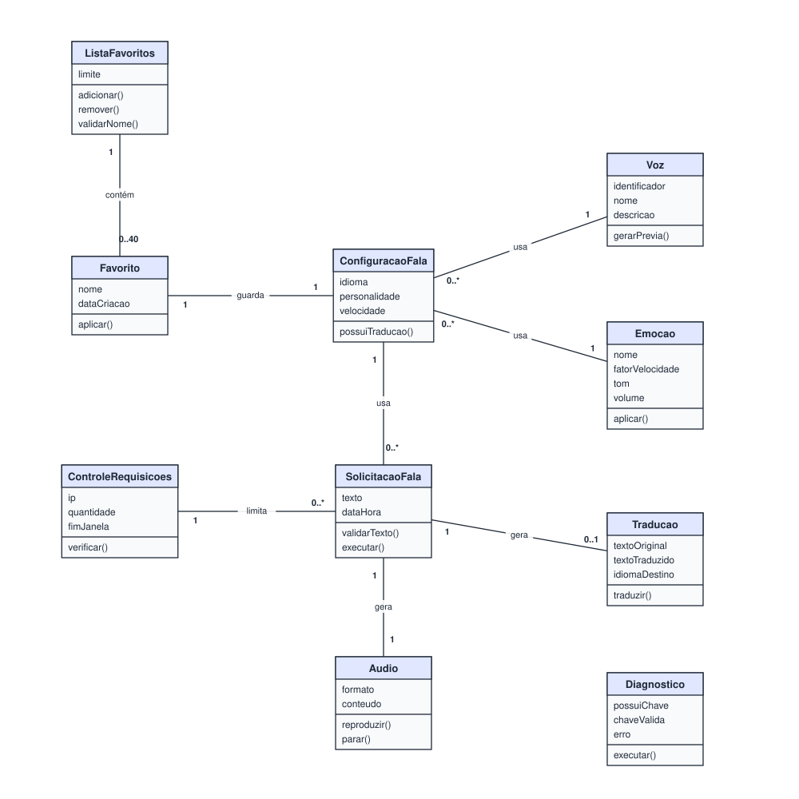

# 4. Classes de Análise

Visão **estrutural** do sistema: quais conceitos existem no domínio do Tradutor Neox e como se relacionam.
Nesta etapa as classes têm apenas nome, atributos e métodos em alto nível, sem tipos nem visibilidade.

## 4.1 Substantivos candidatos

Substantivos grifados nos requisitos (seção 2) e nos casos de uso (seção 3), filtrados pelas heurísticas da aula:

| Substantivo candidato | Classe ou atributo? | Justificativa |
| --- | --- | --- |
| Usuário | Descartado | É ator, mas o sistema **não guarda dados** sobre ele (não há cadastro — RNF-08) |
| Administrador | Descartado | Mesmo motivo do Usuário |
| Texto | Atributo | Vira `texto` de `SolicitacaoFala` |
| Solicitação de fala | Classe | Representa a transação "falar este texto com esta configuração"; tem dados próprios (texto, data/hora) e comportamento (validar, executar) |
| Tradução | Classe | Tem dados próprios (texto original, texto traduzido, idioma) e é gerada a partir de uma solicitação |
| Idioma | Atributo | Na análise é apenas um nome (`idioma` de `ConfiguracaoFala`, `idiomaDestino` de `Traducao`) |
| Voz | Classe | Tem dados próprios (identificador, nome, descrição) e existe independente de qualquer configuração |
| Prévia | Método | Não guarda dados: é o comportamento `gerarPrevia()` de `Voz` |
| Emoção | Classe | Tem dados próprios (fator de velocidade, tom, volume) e comportamento (`aplicar()`) |
| Personalidade | Atributo | É só um texto livre da configuração |
| Velocidade | Atributo | É só um número da configuração |
| Configuração de fala | Classe | Agrupa voz, emoção, idioma, personalidade e velocidade escolhidos |
| Favorito | Classe | Guarda uma configuração com nome e data de criação |
| Lista de favoritos | Classe | Tem regra própria (limite de 40, nome único) e comportamento (adicionar, remover) |
| Áudio | Classe | Tem dados próprios (formato, conteúdo) e comportamento (reproduzir, parar) |
| Limite de requisições | Classe (`ControleRequisicoes`) | Guarda contagem por IP e fim da janela, e tem comportamento (`verificar()`) |
| Mensagem de erro | Descartado | É saída da interface, não um conceito do domínio |
| Diagnóstico | Classe | Tem dados próprios (possui chave, chave válida, erro) |
| OpenAI | Descartado na análise | É ator externo; vira a classe de fronteira `ServicoIA` no projeto (seção 5) |
| Navegador | Descartado | Fora do escopo — é o ambiente de execução |
| Caractere | Descartado | É apenas a unidade de medida do contador |

> **Sinônimos tratados:** "favorito" e "preset" são o mesmo conceito (usamos **Favorito**); "fala", "síntese"
> e "áudio gerado" foram separados em `SolicitacaoFala` (o pedido) e `Audio` (o resultado).

## 4.2 Diagrama de classes de análise

Arquivo editável no Draw.io: [`diagramas/classes-analise.drawio`](diagramas/classes-analise.drawio)

## 4.3 Leitura das associações

| Associação | Multiplicidade | Leitura |
| --- | --- | --- |
| ListaFavoritos — Favorito | `1` — `0..40` | Uma lista contém de zero a 40 favoritos; cada favorito pertence a uma lista |
| Favorito — ConfiguracaoFala | `1` — `1` | Cada favorito guarda exatamente uma configuração |
| ConfiguracaoFala — Voz | `0..*` — `1` | Cada configuração usa uma voz; uma voz pode estar em várias configurações |
| ConfiguracaoFala — Emocao | `0..*` — `1` | Cada configuração usa uma emoção; uma emoção pode estar em várias configurações |
| SolicitacaoFala — ConfiguracaoFala | `0..*` — `1` | Cada solicitação usa uma configuração |
| SolicitacaoFala — Traducao | `1` — `0..1` | Uma solicitação gera no máximo uma tradução (zero quando "Sem tradução") |
| SolicitacaoFala — Audio | `1` — `1` | Toda solicitação concluída gera um áudio |
| ControleRequisicoes — SolicitacaoFala | `1` — `0..*` | O controle de um IP limita as várias solicitações feitas por ele |

> `Diagnostico` não se associa às demais classes do domínio: ele só se relaciona com o serviço externo,
> o que aparece no diagrama de projeto.
