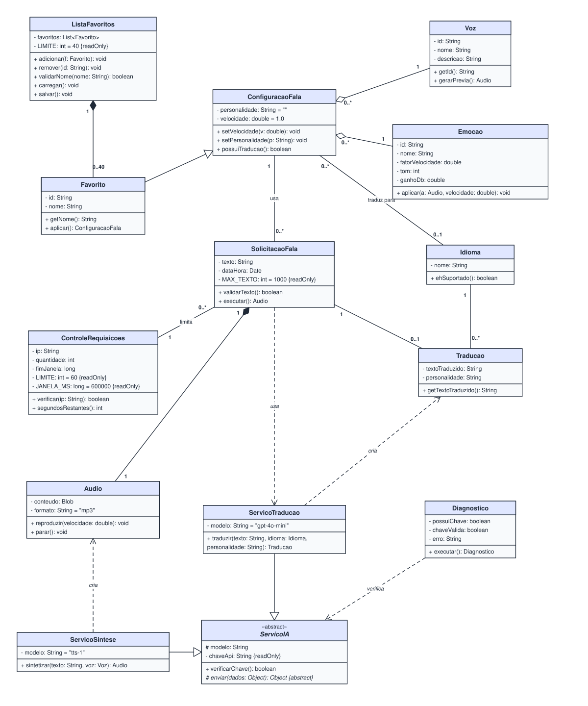

# 5. Diagrama de Classes de Projeto

Refinamento das classes de análise (seção 4) com a notação completa da UML:
visibilidade, tipos, valores iniciais, propriedades e os tipos de relacionamento.

## 5.1 Da análise ao projeto

| Classe de análise | Classe de projeto | O que mudou |
| --- | --- | --- |
| `Voz` (identificador, nome, descricao) | `Voz` (-id: String, -nome: String, -descricao: String, +gerarPrevia(): Audio) | Tipos, visibilidade e retorno dos métodos |
| `ConfiguracaoFala` (idioma, personalidade, velocidade) | `ConfiguracaoFala` (-velocidade: double = 1.0, ...) | O atributo `idioma` virou associação com a nova classe `Idioma`; valores iniciais definidos |
| `Favorito` (nome, dataCriacao) + associação 1—1 com `ConfiguracaoFala` | `Favorito` **é uma** `ConfiguracaoFala` | A associação 1—1 virou **generalização**: um favorito é uma configuração com nome |
| `Traducao` (textoOriginal, textoTraduzido, idiomaDestino) | `Traducao` como **classe associativa** | Existe na relação entre `SolicitacaoFala` e `Idioma` |
| Ator externo OpenAI | `ServicoIA` «abstract», `ServicoTraducao`, `ServicoSintese` | Classes de fronteira que encapsulam o serviço externo |

## 5.2 Diagrama

Arquivo editável no Draw.io: [`diagramas/classes-projeto.drawio`](diagramas/classes-projeto.drawio)

## 5.3 Classes

### ConfiguracaoFala

| Membro | Descrição |
| --- | --- |
| `- personalidade: String = ""` | Personalidade da tradução, até 100 caracteres (RN-06) |
| `- velocidade: double = 1.0` | Velocidade de reprodução entre 0,6 e 1,6 (RN-07) |
| `+ setVelocidade(v: double): void` | Altera a velocidade respeitando a faixa permitida |
| `+ setPersonalidade(p: String): void` | Altera a personalidade respeitando o tamanho máximo |
| `+ possuiTraducao(): boolean` | Retorna verdadeiro quando há idioma de destino associado |

### Favorito *(subclasse de ConfiguracaoFala)*

| Membro | Descrição |
| --- | --- |
| `- id: String` | Identificador único (UUID) |
| `- nome: String` | Nome único e obrigatório (RN-09) |
| `+ aplicar(): ConfiguracaoFala` | Devolve a configuração para preencher a tela |

### ListaFavoritos

| Membro | Descrição |
| --- | --- |
| `- favoritos: List<Favorito>` | Favoritos do navegador, do mais novo para o mais antigo |
| `- LIMITE: int = 40 {readOnly}` | Quantidade máxima (RN-08) |
| `+ adicionar(f: Favorito): void` | Insere no topo e descarta o excedente |
| `+ remover(id: String): void` | Exclui um favorito |
| `+ validarNome(nome: String): boolean` | Verifica se o nome não é vazio nem repetido |
| `+ carregar(): void` / `+ salvar(): void` | Lê e grava a lista no `localStorage` |

### Voz, Emocao e Idioma

| Classe | Membros principais |
| --- | --- |
| `Voz` | `- id`, `- nome`, `- descricao: String`; `+ gerarPrevia(): Audio` |
| `Emocao` | `- fatorVelocidade: double`, `- tom: int` (cents), `- ganhoDb: double`; `+ aplicar(a: Audio, velocidade: double): void` |
| `Idioma` | `- nome: String`; `+ ehSuportado(): boolean` (RN-03) |

### SolicitacaoFala, Traducao e Audio

| Classe | Membros principais |
| --- | --- |
| `SolicitacaoFala` | `- texto: String`, `- dataHora: Date`, `- MAX_TEXTO: int = 1000 {readOnly}`; `+ validarTexto(): boolean`, `+ executar(): Audio` |
| `Traducao` | `- textoTraduzido: String`, `- personalidade: String`; `+ getTextoTraduzido(): String` |
| `Audio` | `- conteudo: Blob`, `- formato: String = "mp3"`; `+ reproduzir(velocidade: double): void`, `+ parar(): void` |

### Serviços e controle

| Classe | Membros principais |
| --- | --- |
| `ServicoIA` «abstract» | `# modelo: String`, `- chaveApi: String {readOnly}`; `+ verificarChave(): boolean`, `# enviar(dados: Object): Object {abstract}` |
| `ServicoTraducao` | `- modelo = "gpt-4o-mini"`; `+ traduzir(texto: String, idioma: Idioma, personalidade: String): Traducao` |
| `ServicoSintese` | `- modelo = "tts-1"`; `+ sintetizar(texto: String, voz: Voz): Audio` |
| `ControleRequisicoes` | `- ip: String`, `- quantidade: int`, `- fimJanela: long`, `- LIMITE: int = 60 {readOnly}`, `- JANELA_MS: long = 600000 {readOnly}`; `+ verificar(ip: String): boolean`, `+ segundosRestantes(): int` |
| `Diagnostico` | `- possuiChave: boolean`, `- chaveValida: boolean`, `- erro: String`; `+ executar(): Diagnostico` |

## 5.4 Relacionamentos (aplicando a árvore de decisão)

| Relacionamento | Tipo | Justificativa |
| --- | --- | --- |
| `Favorito` → `ConfiguracaoFala` | **Generalização** | Um favorito **é uma** configuração de fala com nome e id |
| `ServicoTraducao` / `ServicoSintese` → `ServicoIA` | **Generalização** | Ambos **são** serviços de IA; cada um implementa `enviar()` com um modelo diferente. `ServicoIA` é abstrata e nunca é instanciada |
| `ListaFavoritos` ◆— `Favorito` | **Composição** (`1` — `0..40`) | A parte não sobrevive sem o todo: ao limpar a lista do navegador, os favoritos deixam de existir |
| `SolicitacaoFala` ◆— `Audio` | **Composição** (`1` — `1`) | O áudio só existe como resultado de uma solicitação; descartada a solicitação, o áudio é descartado |
| `ConfiguracaoFala` ◇— `Voz` | **Agregação** (`0..*` — `1`) | A configuração "tem uma" voz, mas a voz sobrevive sem a configuração e é compartilhada por várias |
| `ConfiguracaoFala` ◇— `Emocao` | **Agregação** (`0..*` — `1`) | Mesmo raciocínio da voz |
| `ConfiguracaoFala` — `Idioma` | **Associação** (`0..*` — `0..1`) | "Traduz para": zero idiomas quando "Sem tradução" |
| `SolicitacaoFala` — `ConfiguracaoFala` | **Associação** (`0..*` — `1`) | A solicitação usa a configuração atual, sem ser parte dela |
| `ControleRequisicoes` — `SolicitacaoFala` | **Associação** (`1` — `0..*`) | O controle de um IP limita as solicitações feitas por ele |
| `Traducao` entre `SolicitacaoFala` e `Idioma` | **Classe associativa** | `textoTraduzido` e `personalidade` não pertencem nem só à solicitação nem só ao idioma: existem na relação entre os dois |
| `SolicitacaoFala` ⇢ `ServicoTraducao` | **Dependência** | Vínculo temporário: o serviço é usado durante `executar()` |
| `ServicoTraducao` ⇢ `Traducao`, `ServicoSintese` ⇢ `Audio` | **Dependência** | Os serviços criam esses objetos como retorno dos métodos |
| `Diagnostico` ⇢ `ServicoIA` | **Dependência** | Usa `verificarChave()` durante `executar()` |

## 5.5 Checklist de refinamento

| Item | Verificação |
| --- | --- |
| **Dinâmico** | Todo caso de uso tem classes que o suportam: UC01 → `SolicitacaoFala`/`ServicoSintese`/`Audio`; UC02/UC03 → `ServicoTraducao`/`Traducao`; UC04 → `Emocao`; UC05/UC06 → `Voz`; UC07 → `ConfiguracaoFala`; UC08–UC10 → `ListaFavoritos`/`Favorito`; UC11 → `Diagnostico`; UC13 → `ControleRequisicoes` |
| **Estático** | Todos os atributos têm tipo e visibilidade; constantes marcadas com `{readOnly}` |
| **Estrutural** | Toda associação tem multiplicidade nas duas pontas; não há classes soltas sem relação |
| **Nomenclatura** | Classes no singular em PascalCase; atributos e métodos em camelCase; métodos com verbo |
| **Duplicidade** | "Preset" e "Favorito" unificados; `idioma` deixou de ser atributo repetido em duas classes e virou a classe `Idioma` |

## 5.6 Correspondência com o código

| Classe | Implementação |
| --- | --- |
| `Voz`, `Emocao`, `Idioma` | `lib/constants.ts` (`VOICES`, `EMOTIONS`, `LANGUAGES`) |
| `Emocao.aplicar()`, `Audio.reproduzir()` / `parar()` | `lib/audio.ts` (`playBlobWithEmotion`, `stopEmotionPlayback`) |
| `Favorito`, `ListaFavoritos` | `lib/presets.ts` |
| `ControleRequisicoes` | `lib/ratelimit.ts` |
| `ServicoTraducao` | `app/api/translate/route.ts` |
| `ServicoSintese` | `app/api/tts/route.ts` |
| `Diagnostico` | `app/api/diag/route.ts` |
| `SolicitacaoFala`, `ConfiguracaoFala` | Estado e função `handleSpeak` em `app/page.tsx` |
